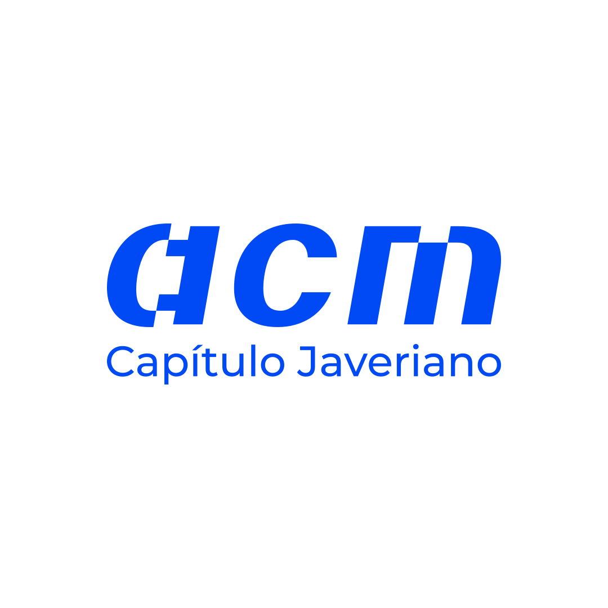
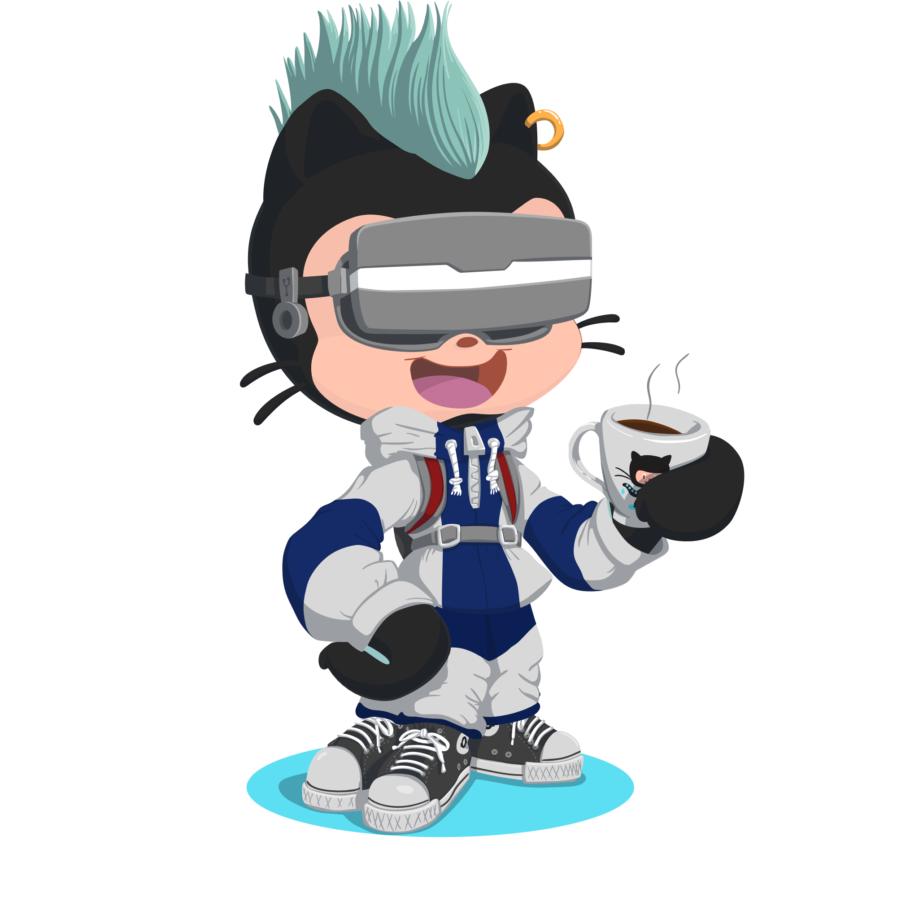

  <!-- Logo ACM Javeriana Oficial -->
  

   

  <!-- Texto dinámico animado (Typewriter) en azul ACM (#004af5) -->
  

   

  <!-- Badges y Contador de Visitas -->
  

    
    &nbsp;
    
    &nbsp;
    
    &nbsp;
    
  

   

  <!-- Mascota Octocat ACM -->
  
   <b>Comunidad & Open Source</b>
  

 

## 🌟 Sobre Nosotros

El **Capítulo Estudiantil ACM de la Pontificia Universidad Javeriana** es un punto de encuentro para mentes apasionadas por la tecnología, las ciencias de la computación y el desarrollo de software. Conectamos el talento javeriano con la industria y el ecosistema global de ciencia y tecnología.

 

| 💡 Aprendizaje & Charlas | 🏆 Competencias & Retos | 🤝 Comunidad & Proyectos |
| :---: | :---: | :---: |
| Talleres prácticos, seminarios técnicos y sesiones de innovación con expertos y egresados. | Entrenamientos y participación activa en maratones de programación competitiva (ICPC, Hackathons). | Espacios de networking, proyectos open source colaborativos e integración estudiantil. |

 

---

## ⚡ Actividad & Estadísticas

  <!-- Animación de streak de actividad -->
  

    

  <!-- Tarjetas de métricas dinámicas de GitHub en tonos azul ACM -->
  
  &nbsp;
  

 

---

## 📬 Conéctate con el Capítulo

¡Participa en nuestras actividades y entérate de convocatorias, eventos y retos!

  
  &nbsp;&nbsp;
  
  &nbsp;&nbsp;
  

 

<!-- Footer con olas animadas fluidas en tonos Azul ACM -->

  

